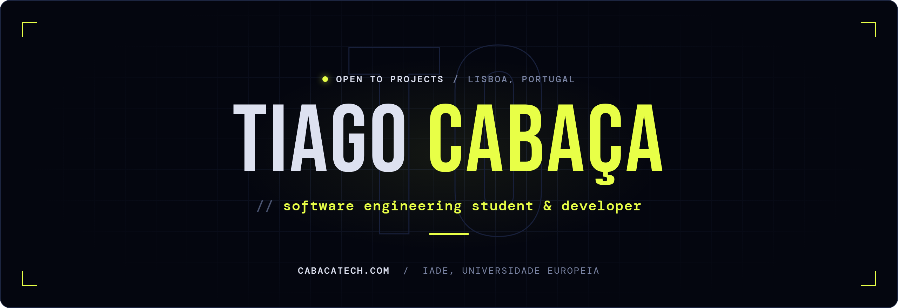
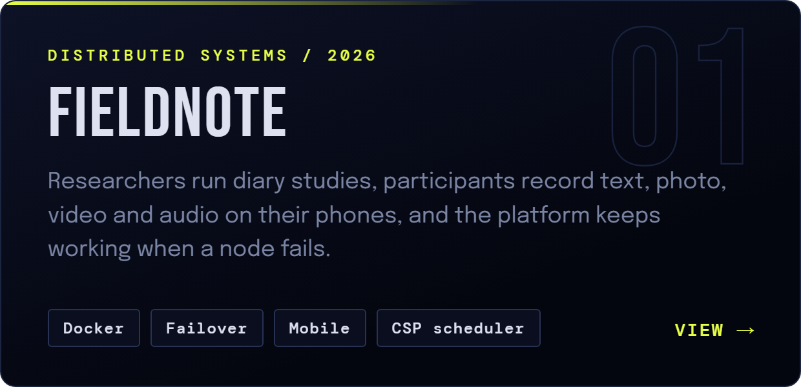
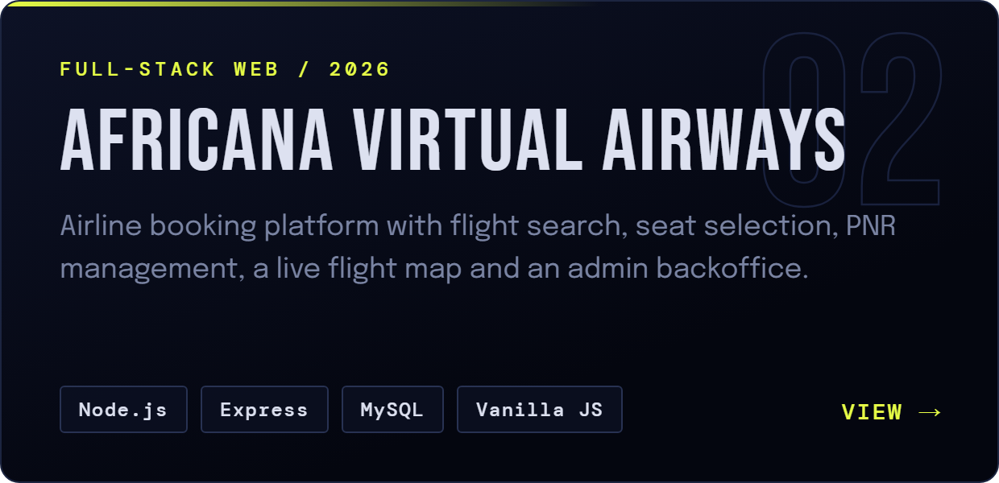
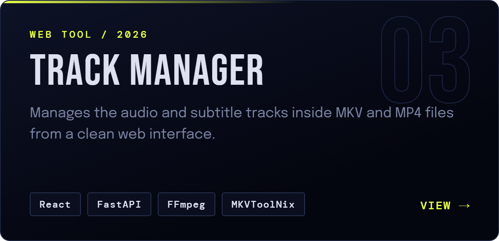
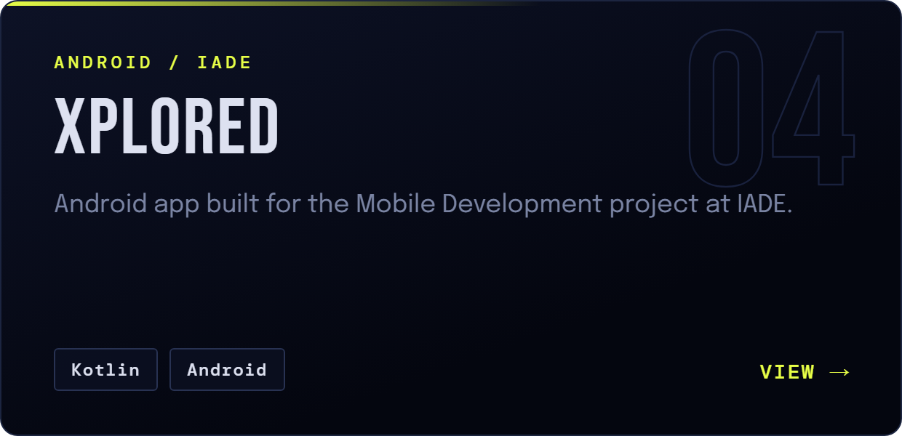
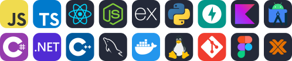

  

  

  <picture>
    <source media="(prefers-color-scheme: light)" srcset="assets/h-about-light.png">
    
  </picture>

  Developer from Lisbon taking a double degree in Informatics Engineering 
  and Management Informatics at <b>IADE, Universidade Europeia</b>. 
  Programming since 2018: web applications, tools for my own use, 
  and the infrastructure that runs them at home. Away from the keyboard, I shoot analogue film.

  <picture>
    <source media="(prefers-color-scheme: light)" srcset="assets/h-now-light.png">
    
  </picture>

  <b>Fieldnote</b> &nbsp;·&nbsp; a fault-tolerant platform for mobile ethnography and diary studies 
  <b>Servidorzinho</b> &nbsp;·&nbsp; my Proxmox homelab, where I run and document my own services 
  <b>cabacatech.com</b> &nbsp;·&nbsp; where I write about both

  <picture>
    <source media="(prefers-color-scheme: light)" srcset="assets/h-work-light.png">
    
  </picture>

  
  

  
  

  <picture>
    <source media="(prefers-color-scheme: light)" srcset="assets/h-stack-light.png">
    
  </picture>

  

  <picture>
    <source media="(prefers-color-scheme: light)" srcset="assets/h-contact-light.png">
    
  </picture>

  
  
  

